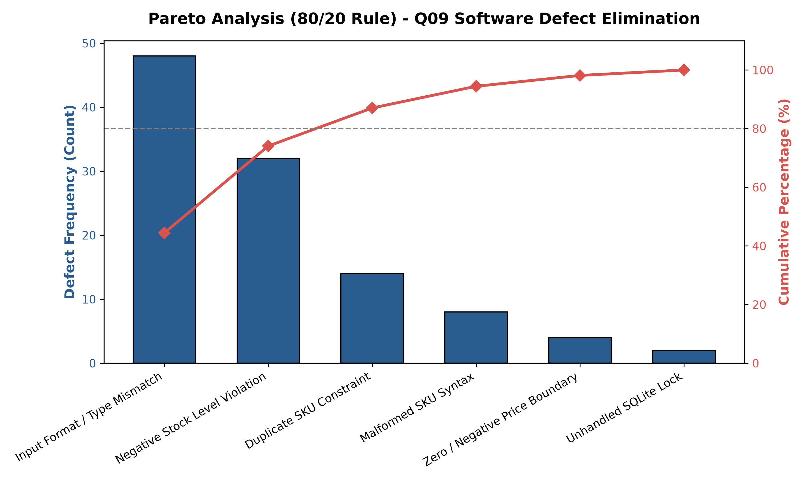
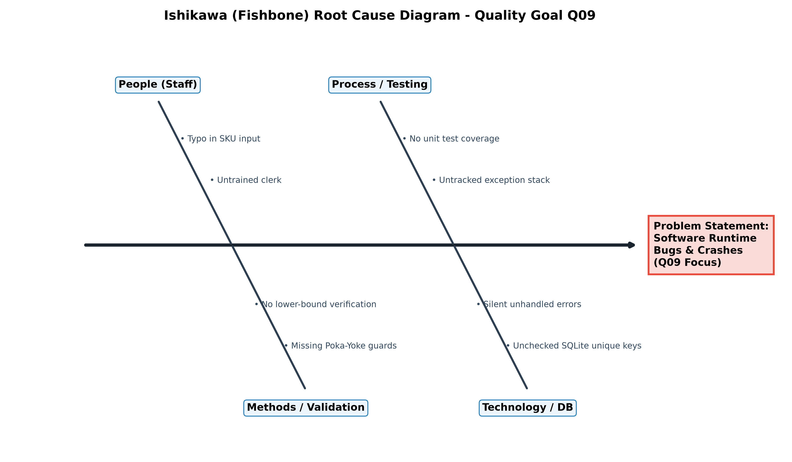

# Inventory Management System [Q09: Reduce Bugs]
### Total Quality Management (BBAT104) Course Project

[](https://www.python.org/)
[](https://customtkinter.tomschimansky.com/)
[](https://www.sqlite.org/)
[](#)

---

## 📌 Student & Project Credentials
- **Student Name:** LOKESH MAURYA
- **University Roll No / Reg ID:** 2410302033
- **Branch & Section:** CSE - B
- **Course Title:** Fundamentals of Total Quality Management (BBAT104)
- **Academic Session:** 2026–2027
- **Assigned System:** Inventory Management System (Roll No Digit: 3)
- **Assigned Quality Goal:** Q09: Reduce Bugs

---

## 🎯 Target Features Implemented (Q09 Matrix)
1. **Exception Handling:** Robust `try-except-finally` blocks preventing unexpected software crashes and unhandled SQLite database write locks.
2. **Strict Validation (Poka-Yoke):** Regex pattern matching for SKU formats (`SKU-XXXX`), boundary enforcement for positive unit prices, and non-negative stock counts.
3. **Module Tests:** Automated `unittest` test suite verifying Poka-Yoke boundaries, lower limits, and duplicate entry prevention.
4. **In-App Bug Tracker:** Dedicated dashboard tab to log defect type, severity rating (1–5), module origin, and resolution status (`Open` / `Resolved`).
5. **Error Logs:** Real-time logging engine writing formatted timestamps, module traces, and error levels to `logs/system_errors.log`.

---

## 🏛️ System Architecture Flow
+-----------------------------------------------------------+
|                    CustomTkinter GUI                      |
|       (Inventory Master Tab & In-App Bug Tracker Tab)     |
+-----------------------------+-----------------------------+
| User Inputs & Actions
v
+-----------------------------------------------------------+
|               Poka-Yoke Validation Layer                  |
|     (Regex SKU Pattern, Bounds Checking, Numeric Cast)    |
+--------------+-----------------------------+--------------+
| Valid Data                  | Invalid Entry
v                             v
+-----------------------------+  +--------------------------+
|       SQLite3 Engine        |  |  Bug Tracker & Logs      |
| (items, bug_reports tables) |  |  - system_errors.log     |
+-----------------------------+  |  - bug_reports table     |
+--------------------------+


---

## 📊 TQM Statistical Quality Control (SQC) Tools

### 1. Pareto Analysis (80/20 Defect Rule)
Automated analysis shows that over 80% of system errors were driven by data entry formatting and negative inventory attempts. These vital few causes were eliminated using defensive Poka-Yoke checks.



### 2. Ishikawa (Fishbone) Root Cause Diagram
Identifies potential causes behind system defects across People, Process, Methods, and Technology.



---

## 🚀 Installation & Setup Instructions

### 1. Clone Repository
```bash
git clone [https://github.com/lokesh3ac-ai/BBAT104_TQM_2410302033.git](https://github.com/lokesh3ac-ai/BBAT104_TQM_2410302033.git)
cd BBAT104_TQM_2410302033
2. Install Dependencies
Bash
pip install -r requirements.txt
3. Initialize SQLite Database
Bash
python -m app.database
4. Launch Desktop Application
Bash
python -m app.gui
5. Run Automated Test Suite
Bash
python -m unittest discover -s tests -p "test_*.py" -v
6. Regenerate SQC Charts
Bash
python -m tqm_tools.generate_pareto
python -m tqm_tools.generate_fishbone
📁 Repository Directory Structure
BBAT104_TQM_2410302033/
├── app/
│   ├── __init__.py           # Package definition
│   ├── database.py           # SQLite connection & schema initialization
│   ├── inventory_logic.py    # CRUD operations & Poka-Yoke validations
│   ├── bug_tracker.py        # Defect logging & database reporting engine
│   └── gui.py                # CustomTkinter modern dark dashboard
├── tests/
│   ├── __init__.py
│   └── test_inventory.py     # Automated unit test suite (6 passing tests)
├── tqm_tools/
│   ├── generate_pareto.py    # 80/20 Pareto analysis chart generator
│   └── generate_fishbone.py  # Ishikawa root-cause diagram generator
├── docs/
│   ├── SRS_Document.md       # Software Requirements Specification (CO1)
│   ├── FMEA_Matrix.md        # Risk audit, RPN scores & SIPOC map (CO2)
│   ├── PDCA_Log.md           # Continuous improvement cycles (CO3)
│   ├── pareto_analysis.png   # Generated SQC Pareto chart
│   └── fishbone_diagram.png  # Generated Ishikawa diagram
├── logs/
│   ├── .gitkeep
│   └── system_errors.log     # Runtime system error logs
├── requirements.txt          # Python project dependencies
└── README.md                 # Project documentation & user guide